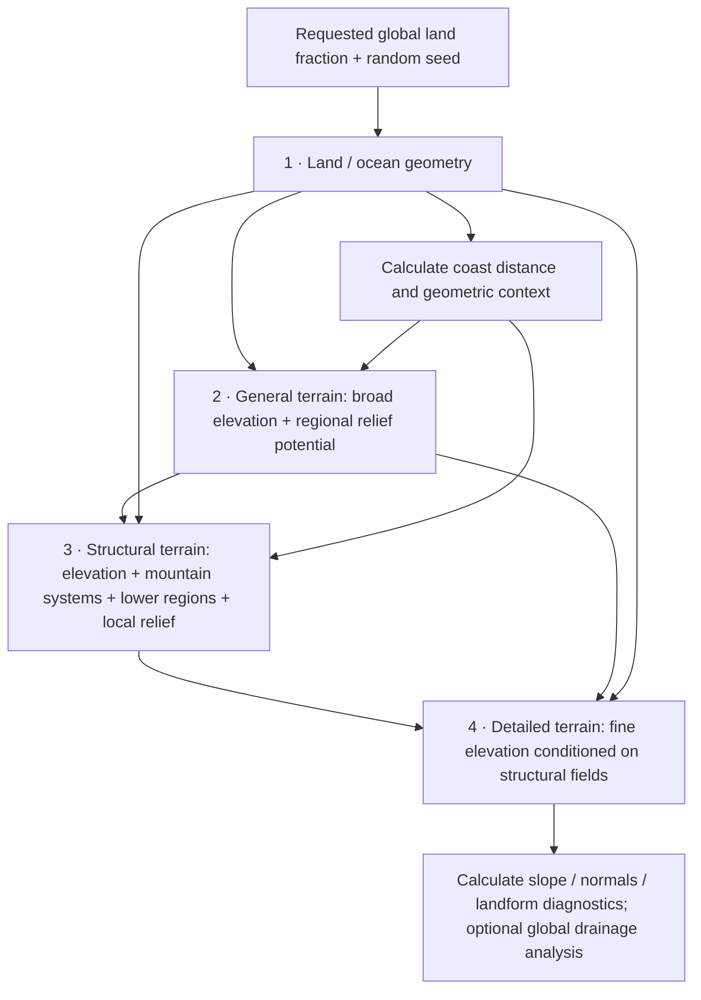

# Terrain generation flow plan

**Proposed design, not an implemented replacement.** Four logical stages generate increasingly specific geography. Useful earlier fields remain available to later stages. Multiple output fields do not imply more stages or one network per field. Selected checkpoints remain unchanged; this plan launches no training or model generation.

Open the [illustrated flow plan](../outputs/terrain-flow-plan/index.html), [ideal Earth stage references](../outputs/terrain-flow-plan/ideal-earth-stages.png), or [ideal field relationships](../outputs/terrain-flow-plan/ideal-field-relationships.png). The Earth panels are supplied design references; the separate field schematic is analytically constructed. Neither is a generated success. [Figure provenance](../outputs/terrain-flow-plan/provenance.json).

## Overall flow

| Stage | Ideally receives | Ideally produces | Decision it owns |
|---|---|---|---|
| 1. Land/ocean | Requested global land fraction; spatially consistent random noise | Coast/domain field `C`; calculated signed coast distance `D` | Continental shapes, islands, seas and their broad arrangement |
| 2. General terrain | `C`, `D`, global geographic context; new noise | Broad elevation/bathymetry `E_b`; **regional relief potential `A_b`** | Continental-scale height/depth envelopes and broad allocation of active versus quiet terrain |
| 3. Structural intermediate | `E_b`, `A_b`, retained `C`/`D`, neighbouring/global context; new noise | **Joint** structural elevation `E_s`, mountain-system support `M`, lower-region support `L`, local relief `R_s` | Where systems, adjacent low regions, secondary relief, plains/plateaus and transitions actually form |
| 4. Detail | `E_s`, `M`, `L`, `R_s`, retained coast/broad context; new noise | Fine elevation `E_f`; calculated geometric exports | Smaller ridges/valleys/slopes that preserve the regional arrangement |

The seed specifies a stochastic realization, not a terrain class. Spatial noise must be tied consistently to world coordinates in production. Reusing seeds in controlled regional tests is intentional and is not evidence of literal tile copying.

The only required user-facing geography parameter in this plan is the requested land fraction. Additional fields are sampled outputs or computed context. Mountain-frequency, climate or tectonic controls are not silently assumed to be available.

## Field status legend

- **Generate:** a learned output that carries a decision or information not determined by an earlier output.
- **Calculate:** derived from an existing output using a declared physical/geometric rule; normally no separate prediction head.
- **Pass:** retain a field/context rather than trying to reconstruct it from an RGB image or from one height layer.
- **Optional:** add only if labels, a downstream consumer and an evaluation can justify it. Optional does not mean already implemented.

Predicting a slope already fixed by the generated height is usually redundant. Predicting broad expected relief from detailed training truth, alongside a very coarse height field, can convey additional information. These are different cases.

## Stage 1 — land and ocean geometry

**Input:** requested global land fraction, noise, spherical geometry/coordinate frame. A local region does not receive an independent local land-percentage requirement.

**Generate:** a coast/domain field, resolved into land/ocean geometry `C`. Retain the sampled raw coast representation for diagnostics, but do not call an uncalibrated score a confidence probability.

**Calculate and pass:**

| Field | Definition / units | Why later stages may use it |
|---|---|---|
| Signed coast distance `D` | Physical distance, positive inland and negative offshore | Distinguishes deep interiors, continental margins and small islands without requiring later models to rediscover distances |
| Coast transition band | A declared distance band/resolution footprint around the coast | Identifies where finer shoreline geometry can be resolved; it is not a learned uncertainty estimate |
| Coast normal / tangent, optional | Unit directions in a stated local spherical basis; validity mask where direction is meaningful | Useful for coastal transitions or shelf orientation if distance alone proves insufficient |
| Actual land fraction, diagnostic | Spherical-area fraction of the sampled result | Measures response to the requested condition without forcing an exact percentage |

Compute coast distances on the sphere before cropping, or use a halo exceeding the declared distance truncation radius. An all-land crop must not become "no coast information" merely because its nearest shore lies outside the tile. Normals/vectors must have an explicit local basis and validity at ambiguous points.

**Optional learned field:** subcell land occupancy or finer shoreline geometry, but only if the data and output grid can supervise it. Area fraction within a coarse footprint is not the same label as the sign of its average elevation. It also does not uniquely locate a coastline inside that cell. Do not obtain false finer geometry by merely upsampling a binary mask.

**Ideal example:** several large landmasses, small islands and plausible intervening oceans. A coastal crop contains a coherent boundary; an inland Plains or plateau crop can correctly be entirely land. Requested global land fraction does not dictate each crop's fraction.

**Boundary:** sea level is exactly zero. No global elevation shift, quantile threshold or post-generation land-coverage correction is used to make the requested percentage exact. At a coarse grid, membership describes a footprint, not the sign of every future fine pixel. Finer coast changes must stay compatible with the defined coast representation/resolution, not alter the datum.

## Stage 2 — general terrain and regional relief potential

**Input:** `C`/`D` plus global context, not only a small crop; noise permits different terrain envelopes on the same continental geometry.

**Generate together:**

1. **Broad signed elevation and bathymetry `E_b`, metres.** Sets continental interiors, broad uplands and ocean-depth envelopes. An unsigned magnitude decoded with the coast's sign remains a possible internal representation.
2. **Regional relief potential `A_b`, nonnegative metres at a declared broad neighbourhood.** Expresses expected amplitude of structural relief within a region. This helps distinguish a smooth high plateau from an equally high region likely to contain strong ranges and lower corridors. It guides allocation of terrain activity rather than prescribing the exact ridge or valley pixels.

`A_b` is the main proposed additional learned output outside the intermediate. Its training label must come from richer structural terrain, for example a land-restricted regional relief statistic at a several-hundred-kilometre scale, with coastal ocean depths excluded. It must **not** just be recomputed from the already smoothed `E_b`: that would add no missing information. The 240 km Gaussian neighbourhood in the schematic illustrates the concept; it is not a validated final definition or a tectonic activity measurement.

`A_b` is a soft context field. It is not an elevation floor, a hard cap, a demand for roughness everywhere, or a quota for mountain coverage. The intermediate can concentrate a region's activity into a compact system with broad quiet areas around it.

**Calculate or consider later:** shallow-water/depth bands and broad slope from `E_b`; these can help coastal/seafloor treatment but do not establish geological shelf boundaries. A global drainage/divide sketch could become useful context, but needs explicit handling of basins and stability under structural changes. Neither is a first-version learned target by default.

**Ideal examples:** the Alpine region is a broad elevated context with substantial structural opportunity; California provides a continental margin and interior elevation context, without turning its entire inland slope into one mountain; the Plains are broadly quiet; a high plateau has high `E_b` but can have low activity in its interior. Real plateaus can also contain rugged areas—height alone never determines activity.

**Boundary:** general terrain does not fix every eventual mountain footprint. Preserve broad geography while allowing meaningful local reorganization. The old <=200 m lock and rigid 645 km conservation blocks are policies to reassess explicitly, not requirements implied by zero sea level. Good supplied structure under the old policies shows that removing those policies alone is not a demonstrated fix.

## Stage 3 — structural terrain, jointly with its fields

**Input:** the entire previous field bundle, appropriate regional/global context and new noise. This component owns the actual arrangement of mountain systems and lower terrain. A broad highland does not uniquely specify one valid arrangement.

**Minimum joint learned output:**

| Field | Intended meaning | Ideal behaviour | False success to reject |
|---|---|---|---|
| Structural elevation `E_s` | Physical terrain at structural resolution, in metres | Already shows believable regional organization before detail | A broad ramp decorated later with texture |
| Mountain-system support `M` | Continuous region/corridor support for connected mountain systems | Curved/branching belts, variable widths, associated secondary systems | Every high point is a mountain; isolated positive residuals; one straight line everywhere |
| Lower-region support `L` | Continuous support for connected relative lows, basin floors and inter-range corridors | Extended lower regions related to surrounding ranges; open and closed basins both possible | Scattered pits; requiring all lows to be near sea level or drain to the sea |
| Local relief `R_s` | Intended local variation at a fixed physical neighbourhood, in metres | Strong relief concentrated in active terrain, gentle plains and quiet plateau interiors | Uniform roughness; confusing high elevation with high relief |

`M`/`L` may be encoded as bounded support fields, truncated distance fields or another audited continuous representation. A support value of 0.8 is not automatically a calibrated 80% probability. Their definitions and widths remain design work. Naming a channel "mountains" does not create useful semantic supervision.

Width can first be represented by a region field's spatial extent. Primary/secondary hierarchy may be implicit in support/relief strength; use separate hierarchy channels only if this loses important distinctions. Orientation and width can often be calculated from corridor geometry, with ambiguity masks at junctions and weak features. Prior direction channels had little effect, so they are not automatically essential outputs.

`M`, `L` and `R_s` are not three mutually exclusive terrain classes. A basin can be high in absolute elevation; a plateau can be quiet without being a basin; a narrow range can have lower absolute elevation than a broad plateau. Shared borders and transitions should be gradual where the terrain warrants them.

**Ideal examples:**

- **Alpine-type system:** a compact curved belt, adjacent connected lower terrain and graded foreland transitions. An alternative location/orientation is acceptable in a generated world.
- **California-type system:** a primary range, a connected lower corridor, a secondary range and asymmetric flanks. Success is that relationship, not reproduction of the Sierra Nevada coordinates.
- **Plains transition:** a large connected gentle region, with localized increasing relief toward a mountain margin. Quietness occupies a real region rather than being leftover blank pixels.
- **Plateau:** high structural elevation, relatively quiet interior, with more relief at selected margins or internal systems. A high plateau is not automatically failed mountain generation.

**Boundary:** elevation and fields must agree. A predicted lowland field with no corresponding lower/gentler region is decorative. Yet agreement alone is insufficient: the 5,000-update pilot already produced self-consistent smooth terrain. The labels must describe recognizable systems and the generated sample must have convincing alternatives.

The first `M`/`L` definitions address land terrain; ocean cells require a domain/availability mask, not the interpretation "quiet land." Signed structural bathymetry still exists. Seafloor ridge/trench/seamount fields are optional later additions if ocean morphology becomes a separate objective; they should not inherit terrestrial labels without a definition.

## Stage 4 — detailed terrain and useful final exports

**Input:** `E_s`, `M`, `L`, `R_s`, coast context, neighbouring structural context and consistent detail noise. Retain low-resolution `E_b`/`A_b` where useful for the longer-range context. The current selected meso receives only height and would need a compatible conditioning/training change to use the extra fields.

**Generate:** fine physical elevation `E_f`. Resolve smaller ridges, valleys, foothills and local texture while maintaining the systems and gentle regions supplied by stage 3. Do not expect a roughly 369 km detail patch to repair a missing thousand-kilometre mountain arrangement.

**Calculate and export:** slope, aspect/normals, curvature, resolved-scale local relief and ridge/valley candidates. State the physical neighbourhood/resolution. These can serve rendering, downstream applications and diagnostics without separate output heads. A very fine-looking hillshade does not imply that streams or metre-scale terrain are resolved.

**Optional later fields:** a global drainage graph, flow direction/accumulation, watershed boundaries and potential lake basins, with declared routing assumptions. These are not determined by independent tile gradients alone. Do not silently fill every depression or call every depression a lake; genuine closed basins are valid, and actual water extent needs additional assumptions. Keep raw terrain and any hydrologically modified surface distinct.

**Ideal example:** finer branching ridges and valleys within an established system, smooth appropriate lowlands, secondary ranges still separated, realistic transitions and no seams. Different detail seeds change smaller features without erasing regional organization.

## Example and scale contract

The [Earth overview](../outputs/terrain-flow-plan/ideal-earth-stages.png) derives all four columns from the **same modern Earth region**, not from paired PaleoDEM/modern records. It shows what information is absent after broad averaging and what a structural representation should recover statistically. It is not a claim that conditional generation must reproduce that geography.

All panels cover **1,290.24 km**, north-up. Illustrative native spacings are 161.28 km for coast/broad fields, 40.32 km for structure, and 2.88 km for detail. The chosen grids reflect existing project scales; they do not lock the new design. Structural resolution may need roughly 20–40 km or another choice after width/aliasing checks. Whole-world context, halos and field continuity matter separately from local pixel spacing.

Elevation colours are fixed to -6,000 through +6,000 m, zero datum, with the same NW light and 5x slope shading. Values are colour-clipped for display only. Each field uses its own explicitly labelled units/legend; support colours are not elevation colours. Coast geometry finer than a coarse footprint is not inferred simply by enlarging its mask.

The [constructed field schematic](../outputs/terrain-flow-plan/ideal-field-relationships.png) uses an invented coast, primary/secondary belts, a connecting lower corridor and an elevated quiet plateau to illustrate relationships. Its support fields are authored, not extracted by a proven landform detector. Its coast is analytic; its distance/normal illustrations do not supply a production spherical-distance implementation. This schematic demonstrates the contract, not model capability or a training dataset.

PlanetC remains a separate example of refining the detailed stepped B2W Earth guide. It is not a round-trip or evidence that a coarse-input model invented those systems.

## Supervision, handoffs and field accountability

**Supervision source.** Heights and fields in one paired example must describe the same terrain. Prefer jointly derived modern-Earth examples for developing the structural labels. The smoother PaleoDEMs can still support coast/broad-height learning, but they do not supply missing modern relief-potential, range-system or fine-drainage labels. Mark unavailable supervision as unavailable; do not encode it as zero activity or quiet terrain. Mixed-source learning and a deployment-compatible guide-corruption recipe require explicit design. The ideal line across the existing PaleoDEM/modern boundary remains unpaired.

**Targets.** Do not translate away the broad arrangement the intermediate is expected to learn, or preserve a residual and then assume full Earth structural restoration was supervised. Audit any feasible-target constraints together with the structural fields. If a constraint removes a valley, its field cannot continue claiming it exists.

**Handoffs.** Carry physical spacing, spherical frame, units, encoding/normalization, domain masks and known/unknown label metadata. Resample elevations in physical metres with area-aware rules. Treat support/occupancy fields by their stated semantics, and rotate vectors between local frames. Recompute derivatives at the destination scale when appropriate. Do not treat resampling as new information or redistribute the world to repair an input-field mismatch.

**Responsibility.** Every added learned field needs a label definition, a reason it contains useful information, a downstream consumer and an intervention test. Removing/swapping a field at fixed height/noise should reveal its intended effect. If later stages ignore it, remove it or fix that coupling before expanding the channel list.

**No fabricated drivers.** Plate IDs, tectonic velocities, lithology, rainfall/erosion history and calibrated uncertainty might eventually be useful. Existing DEMs do not directly provide those labels. They are deferred until their source/process and use are defined, rather than being renamed versions of height gradients.

## Recommended first field bundle and decision gates

| Stage | First learned outputs | Calculated/pass-through fields | Defer initially |
|---|---|---|---|
| 1 | Coast/domain `C` | Coast distance `D`, geometry/frame | Subcell occupancy or finer coastline unless supervision warrants it |
| 2 | Broad height `E_b`, regional relief potential `A_b` | Retained `C`/`D`; optional broad depth/slope diagnostics | Geology/tectonics; an unvalidated continental drainage plan |
| 3 | Structural height `E_s`, mountain support `M`, lower-region support `L`, local relief `R_s` | Retained context; optional calculated corridor orientation/width | Extra classes/hierarchy unless the basic fields cannot express needed distinctions |
| 4 | Fine height `E_f` | Retained structural fields; slope/normals/curvature/relief diagnostics | Additional learned rendering maps; detailed hydrology without global consistency |

The first implementation task is a label/field audit with these ideal families, not another long training run. Follow with a bounded joint-learning sanity check, multiple-seed regional generation and field-use interventions in the detail stage. Confirm that organization works before detailed texture is added. Then evaluate production seams and world statistics using the [probability / stratified / declared-best-feature framework](../outputs/terrain-evaluation/proposed-framework-20261013.md).

Capability, frequency and arrangement remain separate questions. Keep both genuinely quiet regions and intended active contexts in the review. A few attractive examples cannot establish a good world; a few quiet examples cannot establish failed mountain generation. This plan changes no selected model and launches no training or planet generation.
